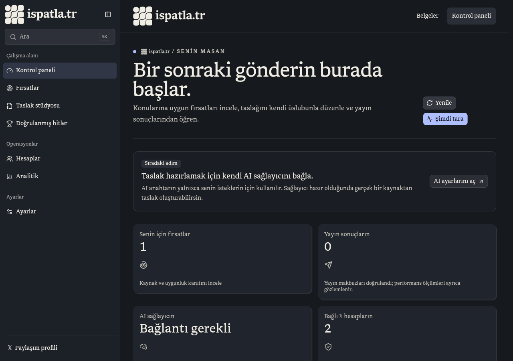
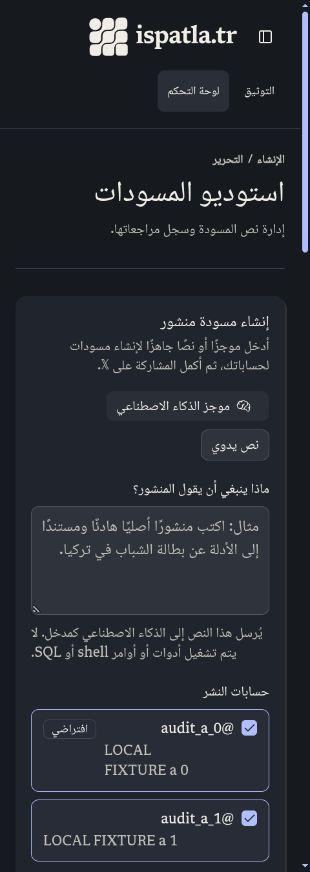

# Full-site verification — 26 October 2026

## Scope

Review the private workspace after the landing work, localize the remaining product surfaces in all 20 supported languages, and use the official social account `https://x.com/ispatlatr`. Preserve the approved landing flow, original slogan, optional review choices, brand assets, and publishing authorization gates.

## Changes verified

- Added 1,203 UI messages with complete values for every supported locale, including interpolation checks. The existing landing, auth, onboarding, public social, and documentation catalogs remain in use.
- Localized dashboard, accounts, categories, sources, writing profiles, competitors, drafts, post detail, queue, evaluation, analytics controls, AI providers, automation, profile, appearance, account lifecycle, email security, MCP grants/authorization, and public privacy/security/terms copy.
- Shared the server-selected locale with client components. Only the selected language is serialized; all of its workspace namespaces remain available during client navigation. User text, account handles, API identifiers, format values, and provider names are preserved.
- Localized accessible sidebar/sheet/spinner labels, search destinations, status labels, numeric/date displays, and previously hardcoded social-image headings. RTL locales place the sidebar on the right.
- Account/category/source selectors display their selected labels instead of underlying numeric IDs or enum values. Missing category inputs are explained before submitting.
- Fixed creating a second custom category: new rows no longer all request primary status. An account-row lock serializes concurrent category creation while preserving the existing primary category.
- Localized protected API error envelopes. Database SQL and bound parameters cannot be returned as visible error text. Unknown backend errors use a localized recovery message; the known quality/human-approval gate retains its explanation.
- Replaced the obsolete translation-in-progress banner with the translated interface. The footer and Twitter metadata point at `@ispatlatr`.

Zustand was considered and not added: the shared state needed here is the request locale; forms and fetched account data already have clear local/server ownership. A second global store would duplicate this state without solving the observed issue.

## Local test environment

A fresh PostgreSQL cluster bound to loopback was migrated with all ten repository migrations. Test-only auth users, sessions, two owners, multiple accounts, categories, drafts, and source observations were created. Automation was disabled. The production build was served on a separate loopback port; the owner's development server was left intact.

No real account credentials, paid AI generation, external posts, actual ownership claims, emails, production database changes, or deployment changes were used for verification. Provider-facing tests use local fixture responses; they do not establish live provider availability.

## Automated verification

- `bun run quality:i18n`: passes across 208 source files; checks static translation calls, raw JSX text, user-facing attributes, and shared heading/text wrappers. Only explicit proper names, protocol examples, and mathematical notation are exempt. Introducing a temporary untranslated button made this check fail as expected; the probe was removed.
- `bun run test`: 276 passed, 10 isolated-database tests skipped, 0 failed; 11,999 assertions across 92 files.
- Isolated PostgreSQL + remote MCP HTTP suite: all 10 passed, 49 assertions. This includes consent/PKCE/revocation, owner isolation, immutable publication receipts, ownership-claim binding, retained user edits, legacy login migration, and concurrent category creation.
- Category regression was reproduced before the fix with `account_categories_one_primary_idx`; the same test passes after the fix.
- API wrapper regressions cover localized auth errors, SQL/parameter redaction, untouched successful user text, unknown-error recovery, approval explanations, and preserved AI machine codes with localized messages.
- Destructive-text contrast failed its regression test at 4.14:1 before the token correction and passes the 4.5:1 requirement afterward.
- CI initially exposed a native Bun 1.3.13 crash during the expanded isolated suite. The package manager pin now matches the locally verified [Bun 1.4.4 release](https://github.com/oven-sh/bun/releases/tag/bun-v1.4.4); application dependencies and the lockfile are unchanged.
- Strict TypeScript, ESLint, and the production build all pass. CI now runs lint, localization coverage, and the complete test suite when product source changes.

## Browser and HTTP verification

- HTTP matrix: 620 requests covering 31 public/private routes × 20 locales, with 0 failures. Checked status, language/direction, heading presence, representative translated headings, and response headers. This verifies rendered server responses, not every possible interactive state.
- Authenticated API matrix: 29 checks, 0 failures. Includes unauthenticated rejection, authenticated reads, two-owner draft isolation, foreign-account access rejection, foreign draft mutation rejection, missing/cross-origin mutation rejection, account reassignment rejection, draft persistence, and revision reads.
- Browser: traversed the private screens at desktop width and ten main screens at 320px. No document-level horizontal overflow. Reviewed Turkish, Arabic RTL, and Japanese layouts; Arabic sidebar appears on the right. Verified actual client navigation from dashboard to accounts retains the selected language.
- Browser → API → DB: saved a draft and inspected its persisted text and revision records. A draft without quality/human approval was refused by the queue. Created a second category through the form and confirmed the original remains primary while the new category is secondary.
- Browser: owner B sees its own draft and none of owner A’s fixture text. A new user is redirected to onboarding; after supplying a local account fixture, the wizard persists completion, allows skipping AI setup, renders localized appearance controls, and opens Opportunities.
- Landing Lighthouse, mobile: performance **90**, accessibility **100**, best practices **100**, SEO **100**. Desktop: **100** in all four categories. These are local lab measurements, not field performance guarantees.
- Private Lighthouse checks: Dashboard, Drafts, Accounts, Sources, Writing preferences, AI keys, Evaluation, and Queue all score **100 accessibility**. Seven score **100 best practices**; AI keys scores **96** because the existing Arena availability endpoint intentionally returns HTTP 503 during its PostgreSQL migration. The UI shows the localized unavailable state. No ranking data was fabricated or external provider call enabled to change this result.
- The final shared search trigger has no accessible-name mismatch. The corrected red button/badge/alert contrast, draft heading order, and JSON editor label pass the page audits. Actual authenticated browser console checks were empty during dashboard refresh and search navigation.
- The JSON editor diff preserves user-entered values such as `Draft` verbatim while translating surrounding Before/After labels. The unsaved probe was reverted.

## Captured local views

Both images use isolated test data, not production accounts or performance observations.

## Remaining external boundaries

Real 𝕏 OAuth, ownership confirmation, live post publication/receipts, paid AI requests, email delivery, and production deployment were not performed. Historical analytics and the Arena ranking migration remain pre-existing unavailable capabilities with explicit UI states; this audit does not claim those services are operational.
