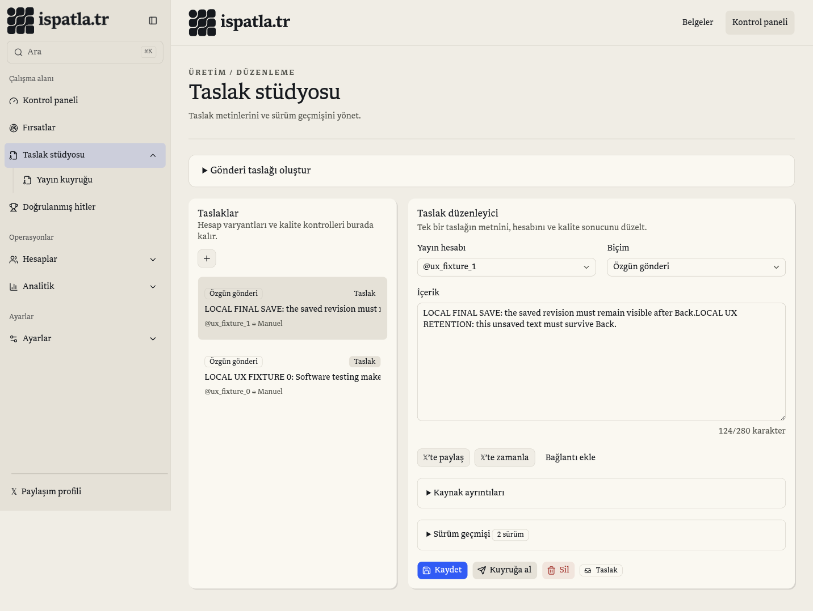

# Usability and SEO verification ⁜ 27 October 2026

Repository: `/home/borat/Projects/ISPATLA`, baseline `0b87e6e`. The desktop project labelled ispatla.tr was mapped to onur.af; that incorrect workspace received no product code edits. Its temporary audit note was removed and its fixture server stopped. The existing unrelated untracked campaign-preview test was preserved.

## Changes

- Nested sidebar pages have their own disclosure buttons: opening a group does not navigate to its parent. Link selection dismisses the mobile sheet. Search keyboard order follows the actual visible groups, and active results scroll into view. Dashboard draft links select the corresponding draft.
- Draft creation and editing have separate format and source state. Opening a source reply starts blank. Optional source details, history and evaluation use native disclosures. Existing drafts open with the composer collapsed. Selecting a draft focuses its editor. The technical shell/SQL disclaimer and source-less Market variant button no longer occupy the primary flow.
- Unsaved edits cannot be shared/queued as an older saved revision. Network failures release pending controls and retain text for retry. Switching or replacing an edited draft requires an explicit discard. Beforeunload protects full document exits; owner/context-scoped tab memory retains editor/composer input for client navigation and Back. Recovery replays only edited fields onto the latest server revision; a deleted draft can be recovered as new text. No browser-storage or server autosave was added.
- One stable reviewed PNG remains authoritative across themes, accent changes and navigation. Removed the extra client-generated data-URL favicon and its head mutation observer. Metadata declares the actual 180×180 dimensions. Legacy `/favicon.ico` resolves to the same PNG. No image identity was redesigned.
- Auth/private routes inherit noindex; valid public metadata, profiles, leaderboard and public observation shares opt into indexing. Home includes canonical WebSite identity alongside the existing software description.
- `bun run quality:seo <origin>` audits real responses for sitemap pages in all 20 locales as Googlebot and a social crawler, checks canonical/hreflang clusters, document language/direction, title/description, h1, social identity/images, JSON-LD, stable favicon bytes/size/type, robots crawler rules, login noindex and real missing-route 404s. It fetches the 120 actual 1200×630 social PNGs. CI now builds and runs this HTTP gate, including on asset/script changes.

## Research and limits

Reviewed the upstream [HEAD reference](https://github.com/joshbuchea/HEAD) and [Next SEO documentation](https://github.com/garmeeh/next-seo), then checked the relevant patterns against installed Next.js 16.3.2 docs. Native metadata already covers standard tags; no SEO library was installed. No fabricated reviews, keyword blocks, ranking guarantees or artificial modification dates were added.

Google's [favicon guidelines](https://developers.google.com/search/docs/appearance/favicon-in-search) require a crawlable representative square asset with a stable URL. The live public site returned the reviewed 180×180 PNG with HTTP 200 during this run; its static HTML already referenced that brand asset. That observation does not prove what Search Console currently displays. The client-added duplicate was a confirmed ambiguity, not a proven diagnosis of Google's cached icon. Google's recrawl/selection is external and may take days to weeks; neither a local build nor this audit can force a particular Search result.

[Site-name guidance](https://developers.google.com/search/docs/appearance/site-names), [localized versions](https://developers.google.com/search/docs/specialty/international/localized-versions), and [robots interpretation](https://developers.google.com/crawling/docs/robots-txt/robots-txt-spec) informed the identity, reciprocal links and crawler checks.

## Evidence

Before changes, four focused component regressions failed for shared composer/editor state, copied text in a new reply, sharing stale saved text and a rejected save remaining busy. The same checks now pass. Mutation tests reject bad/duplicate canonical tags, missing/duplicate alternate languages, default/data icons, invalid JSON-LD, noindex public pages, missing titles/descriptions/headings, wrong social URLs, duplicate/private/missing sitemap URLs and unrelated robots user-agent groups.

The first run of the HTTP gate against the old production bundle found the old icon query, missing WebSite identity and missing auth noindex. Next's equivalent slashless root URL serialization was separately normalized, with a regression, rather than changing valid URLs to satisfy the checker.

An independent read-only code reviewer found an inherited-noindex regression on public observations, an unmatched robots-group bug and navigation/input-retention gaps. Each was repaired and covered by focused checks.

Final snapshot verification:

| Check | Actual result |
| --- | --- |
| `bun run test` | 292 passed, 10 opt-in integration tests skipped, 0 failed; 12,148 assertions across 97 files |
| `bun run lint` | exit 0 |
| `bun run typecheck` | strict TypeScript, exit 0 |
| `bun run quality:i18n` | exit 0; 208 source files, 1,206 messages |
| `ISPATLA_DEMO=1 bun run build` with loopback fixture configuration | production bundle, exit 0 |
| `bun run quality:seo http://127.0.0.1:3104` | exit 0; 240 rendered page responses, 120 social PNGs, 20 locales, zero failures |
| `git diff --check` | exit 0 |

Browser: expanded Accounts without leaving Drafts; 15 ArrowDown actions selected the 16th displayed search result and scrolled it into view (1px subpixel tolerance). A dirty draft hid sharing and disabled queueing. Navigating to Categories and using Back retained the edit. Saving succeeded in the local fixture; after an explicit route refresh, navigating and returning showed that same saved revision. Both unsubmitted composer modes remained available after navigation. The selected saved editor format stayed unchanged when the separate composer format changed.

Mobile: navigation selection dismissed the sheet; its restored visible Close button worked and measured 44×44 CSS px. Responsive measurements at actual CSS widths 375, 1024 and 1440 passed in both system themes, including reduced motion in dark mode: no document-level horizontal overflow, exactly one stable favicon in the hydrated DOM. Arabic additionally reported `dir=rtl`, dark theme and no overflow at 375px. These are local Chromium observations, not real-device or visitor research.

The in-app browser applies zoom to developer screenshots. CSS viewport values were measured directly; the final desktop screenshot compensates for screenshot zoom. Cropped intermediate captures are not evidence of product overflow. [Viewport observations](usability-viewports.json).

A follow-up read-only review found no remaining blockers in the reviewed patch. CI wiring is included; no new remote GitHub Actions run is claimed.

No deployment, real AI request, email, OAuth grant, external publication or production database mutation was performed. Browser checks use only a dedicated owner and local synthetic accounts/drafts on the pre-existing loopback fixture database. The 10 opt-in database integration tests require their isolated runtime and are reported separately from unit checks.

## Release target inspection

Read-only follow-up on 27 October: Vercel confirms the verified `ispatla.tr` domain belongs to project `ispatla` (`prj_ZZwAWwJdkHqVhGhRrsFgbwnJkYO0`). The current production deployment is `dpl_7eg44iLWtERjKnA9Eo1RsmUoN1sG`, ready on Git `main` at `0b87e6ece3675d493c15eaef42aab72fee25465a`. This matches the reviewed baseline, not the uncommitted patch. Production is configured for Node 24.x; CI now explicitly selects the same major version.

Live homepage/favicon GET requests returned HTTP 200. The live PNG SHA-256 still equals the reviewed brand asset, but live HTML and the legacy redirect retain `?v=20261025`. No Search Console result or Google recrawl was claimed from these requests.

The HTTP SEO gate additionally passed against the production bundle with the exact CI failure conditions: an unreachable loopback database, no valid production auth origin, no automation, and no live provider connections. It checked 240 public responses and 120 social images with zero failures. This verifies public-page resilience while backends are absent; it does not verify authenticated workspace or real provider availability.

Publication remains pending the owner's explicit response to the already presented release approval question. Project/domain/version inspection and CI checks do not constitute that approval. No release was created or promoted.

Additional CI parity evidence: the full production build succeeded with Node **24.22.1**, the configured Vercel major, using the CI's deliberately unreachable database and HTTP-only test auth origin. Serving that bundle under Node 24.22.1 and running the HTTP gate again passed all 240 page responses and 120 social images. Workflow YAML was parsed and its explicit Node 24 setup and rendered gate were checked. This remains local CI-equivalent evidence, not a remote Actions run or a release.
